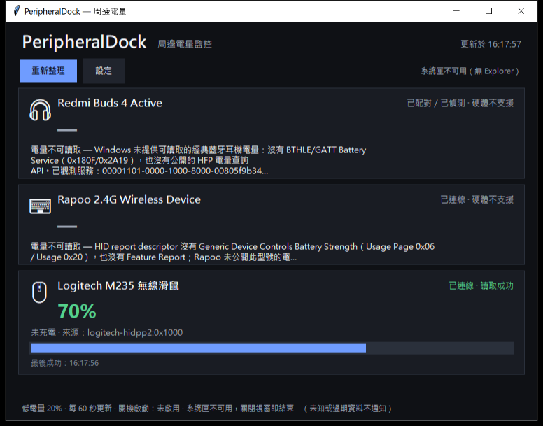

# PeripheralDock

常駐 Windows 系統匣的周邊電量監控工具。目標硬體：

- Redmi Buds 4 Active
- Rapoo E1050
- Logitech M235

核心原則：**只顯示實際讀取到的電量。** 未知就是 `None`，不支援就顯示「電量不可讀取」，不用 100%、估算值或過期資料冒充即時電量。



## 目前實測狀態（2026-11-01）

| 設備 | 狀態 | 本機結果 |
|---|---|---|
| Redmi Buds 4 Active | 不支援（本機） | 經典藍牙已連線，但 Windows 未建立 BLE/GATT 物件；無 `0x180F` 可讀 |
| Rapoo E1050 | 不支援（本機） | HID descriptor 無 Battery Strength；無公開 Rapoo 電量協定 |
| Logitech M235 | **已驗證可讀取** | HID++ 2.0 `BATTERY_STATUS (0x1000)` → 70%，未充電 |

實測環境是 **Windows 10 IoT Enterprise LTSC 2021（19044）**，不是 Windows 11；詳見 [DEVICE_SUPPORT.md](DEVICE_SUPPORT.md)。沒有真機測試的欄位都標為待驗證。

## 功能

- 三張設備卡：耳機 / 鍵盤 / 滑鼠
- 可驗證的電量百分比與進度條
- 讀取狀態：`ok` / `unsupported` / `offline` / `stale` / `error`
- 低電量通知（預設 20%，只在實際有效、在線、未過期時觸發）
- 系統匣圖示（原生 `Shell_NotifyIcon`；無 Explorer 時自動退回視窗模式）
- 手動刷新、自動輪詢、設定保存
- Windows 開機自動啟動（HKCU，預設關閉，免管理員）
- 繁體中文介面
- 全程唯讀硬體探測；不擷取鍵盤輸入、不修改韌體

## 系統需求

- Windows 10 19041+ / Windows 11（實測 19044）
- Python 3.10+（建議 3.11；實測 3.12.14）
- 標準函式庫即可執行；`tkinter` 需隨 Python 安裝
- 不需要管理員權限

## 安裝與執行

```powershell
cd PeripheralDock
python -m venv .venv
.\.venv\Scripts\Activate.ps1
python -m pip install -r requirements.txt
python main.py run
```

或使用：

```powershell
.\run.ps1
```

### CLI

```powershell
# 唯讀探測，輸出 JSON 證據
python main.py probe --json docs/evidence/probe-20261101.json

# 讀取一次並顯示
python main.py once

# 啟動 UI（可加 --minimized）
python main.py run

# 開機啟動管理
python main.py autostart status
python main.py autostart enable
python main.py autostart disable
```

## 設定

設定檔：`%APPDATA%\PeripheralDock\config.json`

| 欄位 | 預設 | 說明 |
|---|---|---|
| `low_battery_threshold` | 20 | 電量等於或低於此值時通知 |
| `poll_interval_seconds` | 60 | 自動刷新間隔（15–3600） |
| `notifications_enabled` | true | 低電量通知開關 |
| `autostart_enabled` | false | 開機啟動；只寫 HKCU Run |
| `start_minimized` | true | 啟動時隱藏到系統匣 |

## 系統匣與通知

- 使用 Win32 `Shell_NotifyIconW`，不需要 `pystray`。
- 點擊圖示會開啟/喚回主視窗。
- 若目前工作階段沒有 Explorer（例如遠端服務工作階段），`Shell_NotifyIcon` 會失敗，程式會在 UI 標示「系統匣不可用」，關閉視窗即結束。
- 通知優先用系統匣 balloon；沒有系統匣時退回對話框。

**待驗證：** 本開發工作階段沒有 Explorer 系統匣，無法實際點擊圖示；程式碼已完成，需在一般 Windows 桌面工作階段驗證。

## 電量資料規則

`read_battery()` 回傳 `BatteryReading`：

| 欄位 | 規則 |
|---|---|
| `percentage` | 0–100 整數或 `None` |
| `charging` | `True` / `False` / `None` |
| `status` | `ok` / `unsupported` / `offline` / `stale` / `error` |
| `source` | 實際協定，例如 `logitech-hidpp2:0x1000` |
| `timestamp` | 最後成功讀取時間 |
| `error_message` | 失敗原因 |

- 讀取失敗後若有 last-good，會回 `stale` 並保留時間戳，UI 標示「過期」。
- `unsupported` 不會被舊資料覆蓋。
- 低電量通知只接受 `status=ok` 且 `connection=connected`。

## 專案結構

```text
PeripheralDock/
  DEVICE_SUPPORT.md       硬體實測報告
  IMPLEMENTATION_PLAN.md  實作計畫
  TEST_PLAN.md            測試計畫
  TEST_RESULTS.md         實測結果
  README.md
  main.py                 dev 入口
  run.ps1 / build.ps1
  src/peripheraldock/
    adapters/             redmi / rapoo / logitech
    windows/              setupapi / hid / hidpp / bluetooth
    service.py            輪詢與快照
    notifications.py      低電量政策
    tray.py               原生系統匣
    ui.py                 Tkinter UI
    autostart.py          HKCU Run
    config.py             JSON 設定
    cli.py                probe / once / run
  tools/
    probe_hardware.py     獨立唯讀探測（見 TEST_RESULTS）
    winrt_probe.ps1       WinRT 經典藍牙 / BLE / GATT 證據
  tests/                  unittest，43 個測試
  docs/evidence/          JSON 與截圖
```

## 測試

```powershell
$env:PYTHONPATH = "src"
python -m unittest discover -s tests -v
```

結果見 [TEST_RESULTS.md](TEST_RESULTS.md)。目前 42 個測試通過，1 個 HKCU 寫入測試因沙箱限制跳過。

## 建置 Windows 可執行檔

需要 PyInstaller（僅建置時需要）：

```powershell
python -m pip install pyinstaller
.\build.ps1
```

輸出：

```text
dist\PeripheralDock\PeripheralDock.exe
```

`build.ps1` 使用 `--windowed --name PeripheralDock --paths src main.py`；不需要管理員權限。若要單檔：

```powershell
.\build.ps1 -OneFile
```

> 本開發環境沒有安裝 PyInstaller，因此未實際產出 `.exe`；流程與參數已寫入 `build.ps1`，需在可安裝建置工具的 Windows 機器執行。

## 安全與隱私

- 不讀取鍵盤按鍵內容；只讀 HID descriptor 與 HID++ 回應。
- 不對未知裝置發送 HID 寫入；Logitech 只發送唯讀 feature request。
- 不修改韌體、不配對/解除配對、不改裝置設定。
- 不要求管理員權限；開機啟動只寫目前使用者 HKCU。
- 應用程式不發送網路請求。
- 第三方參考：Solaar（GPL-2.0-or-later）只用於協定研究，未複製程式碼；詳見 [THIRD_PARTY_NOTICES.md](THIRD_PARTY_NOTICES.md)。

## 授權

本專案原創程式碼採用 MIT License；第三方元件與參考資料另見 `THIRD_PARTY_NOTICES.md`。
